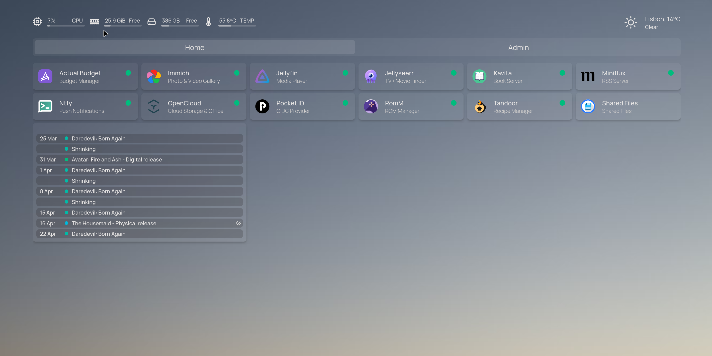
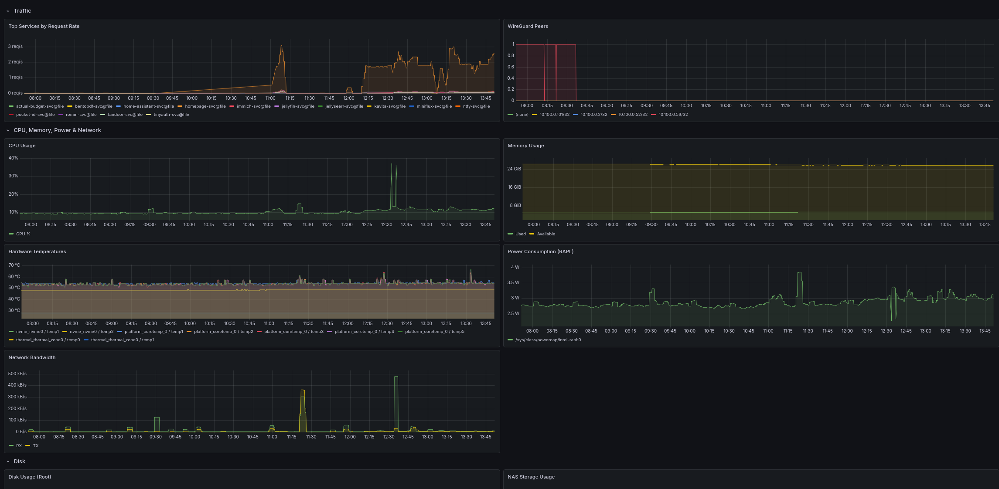
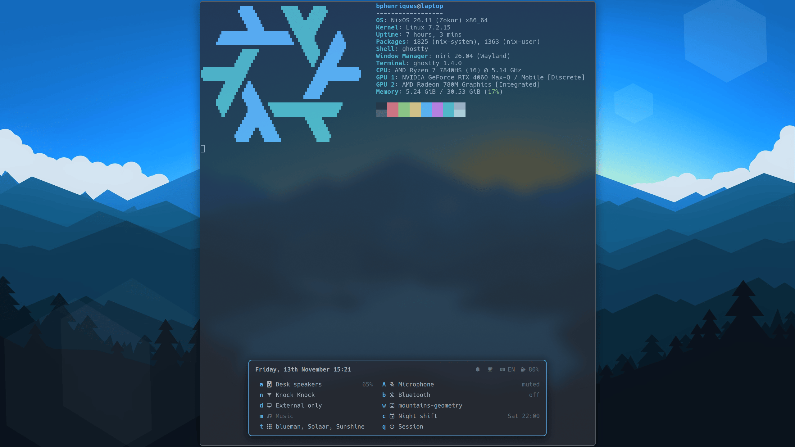
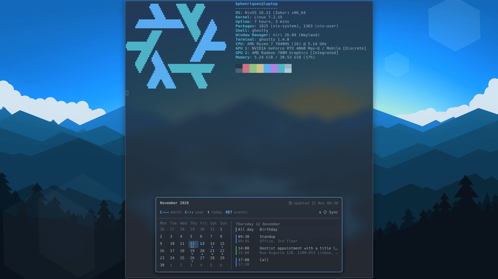
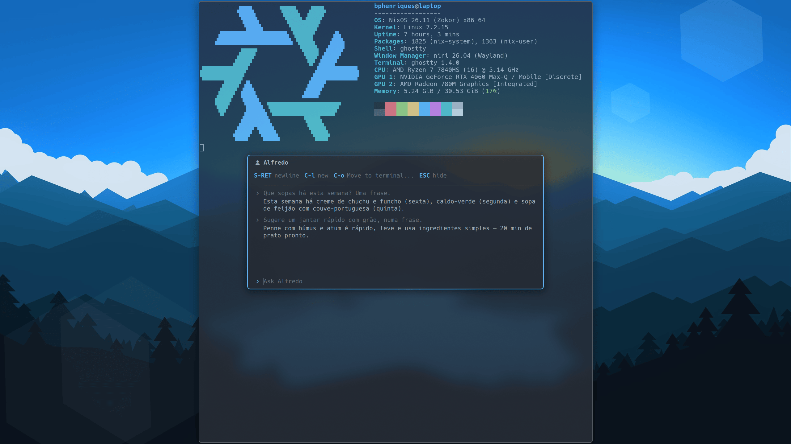

# bphenriques's fleet

[](https://nixos.org/)
[](https://github.com/bphenriques/selfhost-nix)
[](./apps/nixos-install/README.md)
[](./LICENSE.md)

Hi! 👋 This is how I manage my fleet with [NixOS](https://nixos.org/), including a self-hosted homelab running many services with SSO, a reverse proxy, monitoring, and automated off-site encrypted backups (see [`selfhost-nix`](https://github.com/bphenriques/selfhost-nix) and [`compute`'s architecture](./hosts/compute/README.md#architecture)). I hope this helps you!

<p float="center">
  
  
</p>

<p float="center">
  
  
  
</p>

## Hosts

| Host                                                           | Platform      | Description                                            |
| -------------------------------------------------------------- | ------------- | ------------------------------------------------------ |
| [laptop](./hosts/laptop)                                       | NixOS         | Personal laptop                                        |
| [compute](./hosts/compute)                                     | NixOS         | Compute headless server                                |
| [storage](./hosts/storage)                                     | NixOS         | Headless NAS                                           |
| [ai](./hosts/ai)                                               | NixOS         | Headless AI inference                                  |
| [agent-alfredo-vm](./hosts/ai/microvm/guests/agent-alfredo-vm) | NixOS microVM | Private AI assistant                                   |
| [work-macos](./hosts/work-macos)                               | nix-darwin    | Work laptop                                            |

## Nix Stack

Layout:

- [`hosts/`](./hosts): per-host configurations (hardware, services, users)
- [`modules/`](./modules): personal NixOS/home-manager modules (the `selfhost.*` framework lives in [selfhost-nix](https://github.com/bphenriques/selfhost-nix))
- [`profiles/`](./profiles): shared opinionated configuration that *sets* standard options (imported by hosts)
- [`packages/`](./packages): custom packages and scripts
- [`lib/`](./lib): custom helpers and builders
- [`apps/`](./apps): runnable scripts (installation, post-install)

Key dependencies:

- [`disko`](https://github.com/nix-community/disko) for declarative disk partitioning
- [`stylix`](https://github.com/danth/stylix) for consistent theming
- [`sops-nix`](https://github.com/Mic92/sops-nix) for secrets
- [`nixos-anywhere`](https://github.com/nix-community/nixos-anywhere) for remote installations
- [`selfhost-nix`](https://github.com/bphenriques/selfhost-nix) personal flake that does the heavy-lifting when it comes to self-hosting (reverse Proxy, OIDC, and secrets)
- `dotfiles-private` private dependency to store SOPS secrets, personal information, and wallpapers. Typically under `~/.dotfiles-private`.
- [`infra`](./infra) that setups my Cloudflare account through IaC.

Not using [flake-utils](https://github.com/numtide/flake-utils) or [impermanence](https://github.com/nix-community/impermanence) intentionally.

## `dot` cli

A thin wrapper over [`nh`](https://github.com/nix-community/nh) for local and remote machines, called [`dot`](./packages/dotfiles/dotfiles):

```bash
dot . s              # build, preview changes, and apply to the current host
dot . b              # build and preview changes without applying
dot . u              # update flake inputs
dot . c              # show changelog between last two local profiles
dot compute s        # deploy to the compute host remotely
dot compute c        # show changelog for the compute host
```

## AI Disclaimer

Since January 2026 I have been using AI assistants (cloud and self-hosted). I define the architecture, design and expected outcomes and, where it matters, I review changes line by line. Above all, it lets me build and learn faster, while keeping things simple, idiomatic and composable.

## Acknowledgements

Thanks to everyone sharing dotfiles, maintaining the [Arch Wiki](https://wiki.archlinux.org/) and [NixOS Wiki](https://wiki.nixos.org/), and helping in the [NixOS community](https://github.com/NixOS/nixpkgs?tab=readme-ov-file#community).
